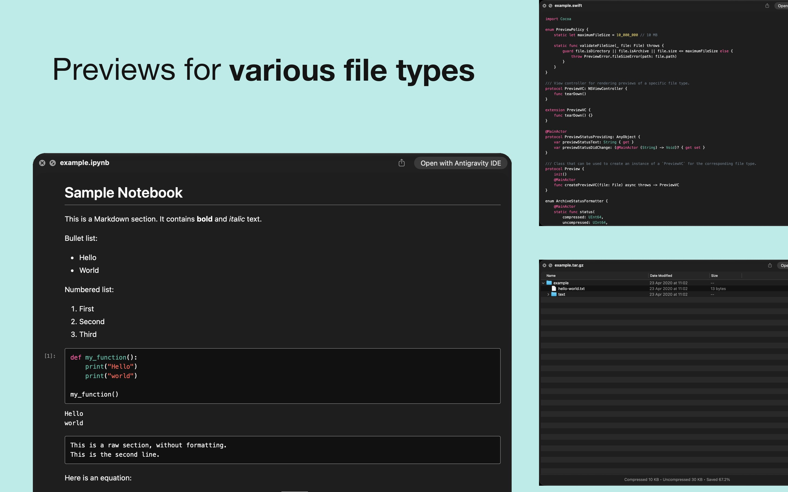
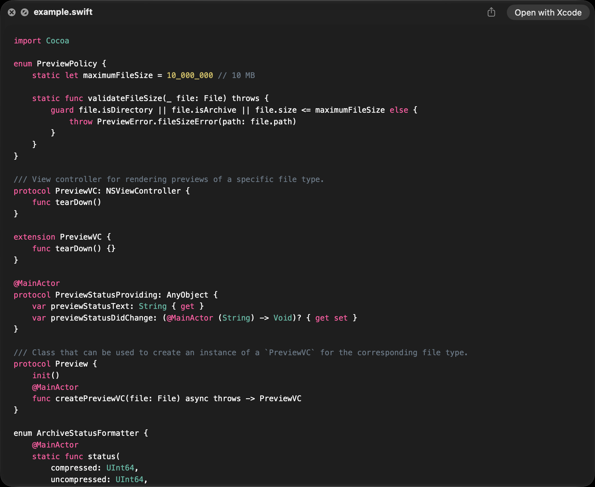
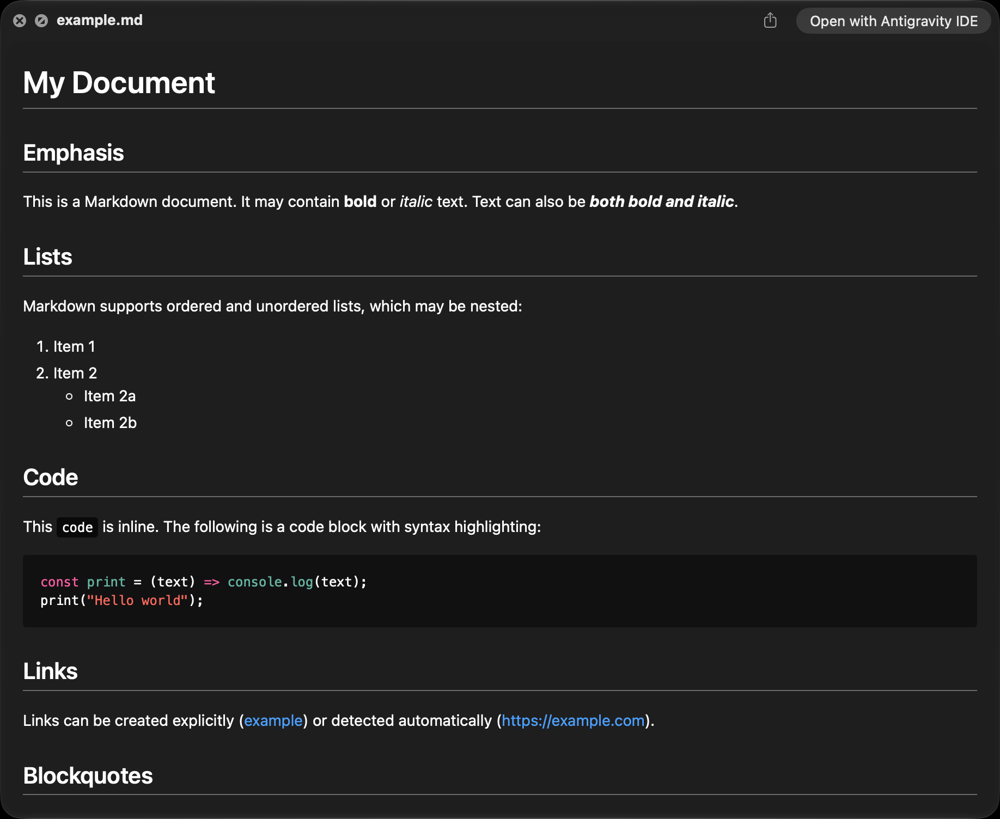
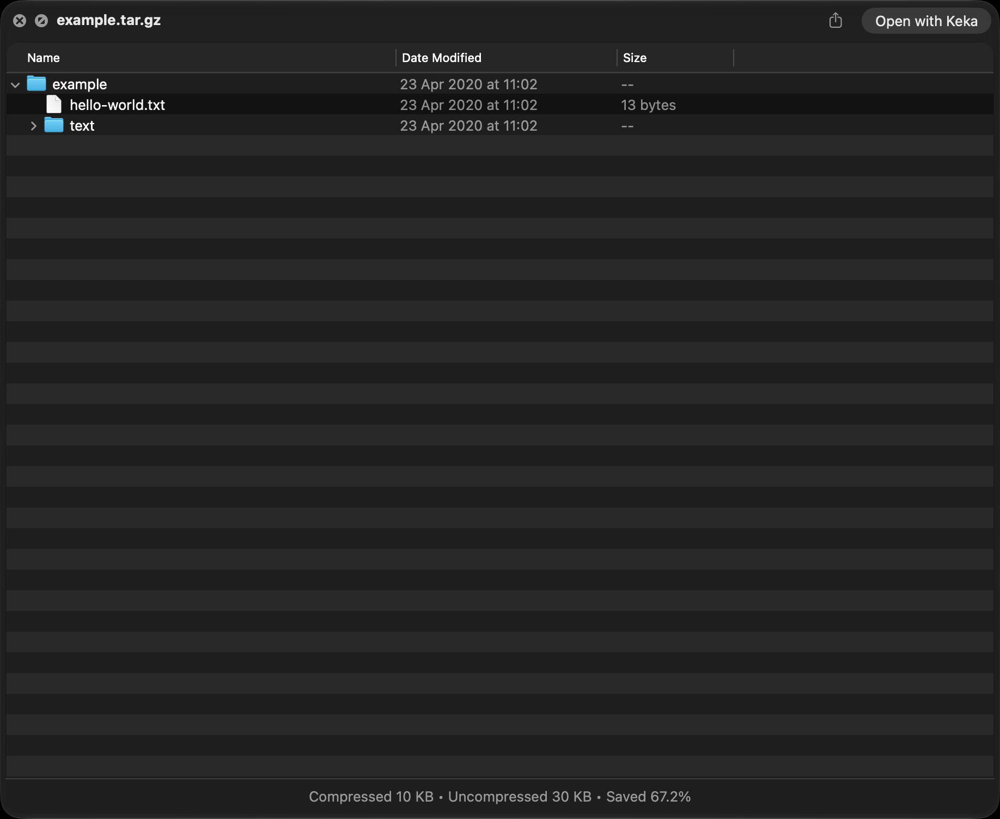
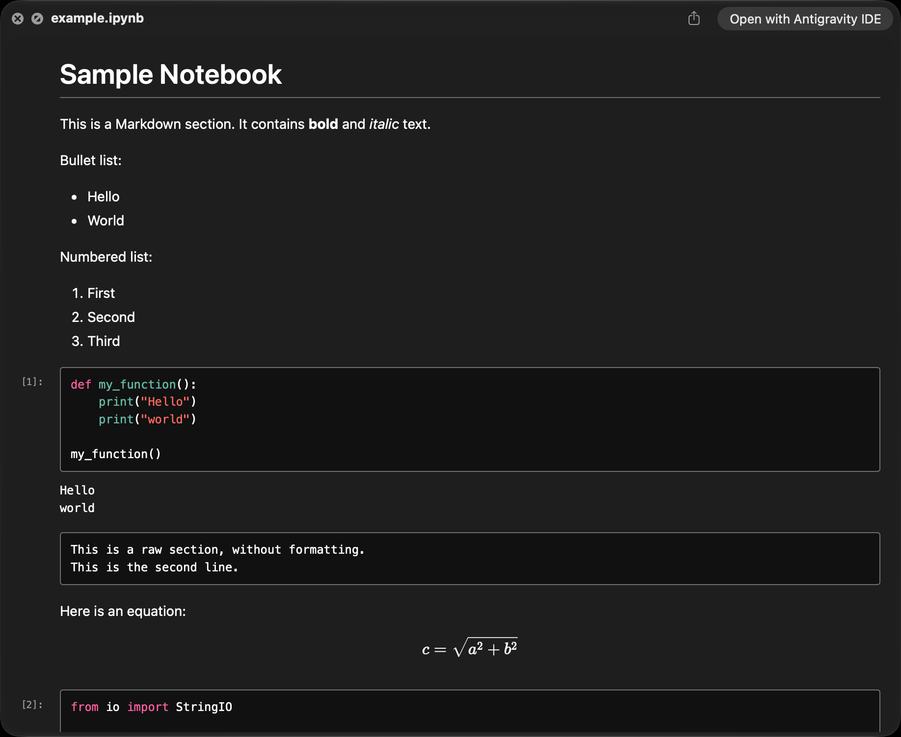
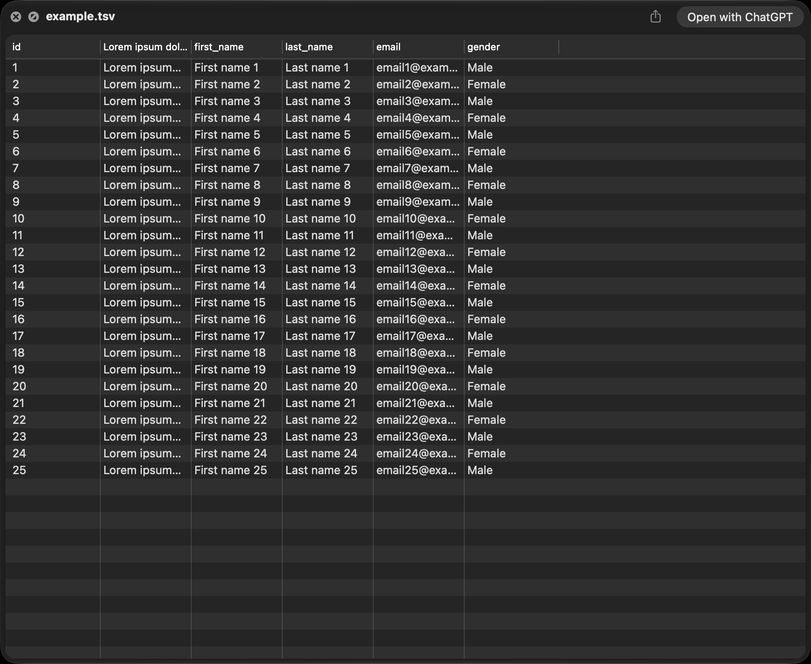

<div align="center">
	<p></p>
	<h1>Glance</h1>
	<p><strong>All-in-one Quick Look plugin</strong></p>
	<p>Glance provides Quick Look previews for files that macOS doesn't support out of the box.</p>
	<p><strong>Version 1.8.2 (build 26)</strong> · macOS 26 or later · Apple silicon</p>
	<p><a href="#installation">Installation Steps</a> · <a href="https://github.com/ranokay/glance/releases"></a></p>
	<p></p>
</div>

> [!NOTE]
> This repository is a fork of [chamburr/glance](https://github.com/chamburr/glance) with additional maintenance and distribution work.
> Compared with upstream, this fork includes:
>
> - native macOS 26 Liquid Glass controls and adaptive window materials
> - Apple silicon-only builds
> - lazy folder previews with Finder-style icons, pagination, and progressive thumbnails
> - in-place previews and multi-level navigation for nested folder items
> - a sandbox-safe Open With chooser that preserves default app associations
> - newer Quick Look and WebKit fixes
> - `.ini`, `.toml`, `.ttml`, and `.elrc` source-code previews
> - expanded archive support
> - secure, offline EPUB 2 and EPUB 3 previews
> - secure, interactive 3MF model previews
> - safer bundled WebKit rendering
> - a bounded Rust preview core with responsive off-main rendering and parsing
> - pinned `mise` build and test tooling with expanded automated coverage
> - downloadable unsigned DMGs from this fork's GitHub Releases
> - Settings controls for Start at Login and preview appearance
>
> Release DMGs are unsigned and unnotarized. Verify the attached SHA-256 checksum before using the quarantine-removal command shown in the installation steps.

## About

Glance extends the native Quick Look experience in Finder, Spotlight, and the Space-bar preview window. This maintained fork builds on [chamburr/glance](https://github.com/chamburr/glance) and the [original Glance plugin](https://github.com/samuelmeuli/glance), modernizing the app for current macOS releases while retaining local, lightweight previews.

Version **1.8.2** (build **26**) requires an Apple silicon Mac running macOS 26 or later. It uses native macOS materials and controls without stacking custom glass effects inside Quick Look's own window chrome.

## Installation

This maintained fork is distributed through [GitHub Releases](https://github.com/ranokay/glance/releases). The upstream Homebrew cask installs a separate upstream build and does not track releases from this fork.

Release DMGs are currently unsigned and unnotarized. To install Glance:

1. Download both `Glance-<version>.dmg` and `Glance-<version>.dmg.sha256` from the same release. In Terminal, change to their download directory and verify the disk image before opening it:

   ```sh
   shasum -a 256 -c Glance-<version>.dmg.sha256
   ```

2. Open the verified disk image and drag Glance.app to Applications.
3. If macOS blocks the app, remove the download quarantine attribute:

   ```sh
   xattr -rd com.apple.quarantine /Applications/Glance.app
   ```

4. Launch Glance once so macOS can register its Quick Look extension.
5. Keep Glance running while using its previews. Glance runs from the menu bar only, with no Dock
   icon or main window. Settings can start Glance at login, customize the font, size, and line
   wrapping used by new code, Markdown, and notebook previews, and manage update checking. Later
   Glance releases download and install inside the app ("Install and Relaunch" in Settings) without
   opening a browser; update integrity is enforced with EdDSA signatures via
   [Sparkle](https://sparkle-project.org). The macOS quarantine step above is a one-time hurdle for
   this first DMG install only — in-app updates are not quarantined.

## Supported file types

- **Lossless audio**: `.flac` files with native playback controls and a bounded waveform overview

- **Folders**: lazy, expandable trees with Finder-style icons and progressive image, video, and PDF
  thumbnails. Glance loads one directory at a time in pages of 500 and skips hidden items.
  Double-click a folder to navigate into it with multi-level Back navigation, or double-click a file
  or package to preview it in place. The utility bar can open a selected nested item once with any
  compatible app without changing its macOS default.

- **Source code and text** (with [two-face/syntect](https://github.com/CosmicHorrorDev/two-face) syntax highlighting): `.cpp`, `.elrc`, `.ini`, `.js`, `.jsonl`, `.py`, `.swift`, `.tmpl`, `.toml`, `.ts`, `.ttml`, `.yml`, common extensionless configuration files, and many more

  <p></p>

- **Markdown** (rendered using [Comrak](https://github.com/kivikakk/comrak), with offline [Mermaid](https://mermaid.js.org/) diagrams rendered by [Pele](https://pele.run/)): `.md`, `.markdown`, `.mdown`, `.mkdn`, `.mkd`, `.Rmd`, `.qmd`

  <p></p>

- **Draw.io diagrams** (rendered locally with the bundled diagrams.net viewer): uncompressed `.drawio`

- **Archive**: `.7z`, `.ear`, `.jar`, `.rar`, `.tar`, `.tar.gz`, `.tgz`, `.war`, `.zip`.
  Double-click a file entry to preview it in place without extracting the whole archive; Back
  returns to the tree. Extracted entries are temporary, capped at 25 MB, and deleted when you leave
  the preview. Nested archives can be opened up to three levels deep.

  <p></p>

- **E-books** (rendered offline by Glance's bounded Rust preview core): DRM-free `.epub` files,
  including package metadata, reading order, internal links, and embedded images

- **3D models** (parsed by Glance's bounded Rust preview core): `.3mf`, with rotation, pan, zoom,
  transforms, units, multipart assemblies, and basic colors

- **Jupyter Notebook** (rendered by Glance's Rust preview core): `.ipynb`

  <p></p>

- **Tab-separated values** (parsed by Glance's bounded Rust preview core): `.tab`, `.tsv`

  <p></p>

- **Spreadsheets** (values-only, parsed by Glance's bounded Rust preview core): `.xlsx`. Every
  worksheet is available from a sheet picker, with dates, booleans, cached formula values, and
  column letters. Cell styles, charts, images, conditional formatting, `.xls`, and `.numbers` are
  not supported.

- **SQLite databases** (read-only, parsed by Glance's bounded Rust preview core): `.sqlite`,
  `.sqlite3`, `.db`. Tables are listed alphabetically and shown 50 rows at a time with declared
  column types, distinct `NULL` and empty values, and BLOB sizes instead of inline bytes. Glance
  never writes to the user's file: it opens immutable when no `-wal` sidecar exists and otherwise
  reads a temporary copy. Encrypted, truncated, or non-SQLite files show a clear message.

- **Structured data** (parsed by Glance's bounded Rust preview core): `.json`, `.plist` (XML and
  binary), and `.xml`. Objects, arrays, and elements are collapsible; strings, numbers, booleans,
  nulls, dates, and data are labelled by type; keys keep their authored order. Malformed input
  falls back to syntax-highlighted text. Files above 4 MB, deeply nested documents, and very large
  trees show an explicit truncation notice instead of failing.

## Images

Two sets, two jobs. The App Store submission set is canonical for the store
listing; the docs set illustrates this README. Neither set is committed by CI —
only deliberate human captures land here.

- Submission (canonical): `AppStore/Listing/Screenshots/Screenshot1.jpg`
  (file-type collage), `Screenshot2.jpg` (Quick Look, Finder and Spotlight),
  `Screenshot3.jpg` (light and dark mode). `Screenshot2.jpg` predates the
  current chrome — refresh pending: capture a current Quick Look preview
  window next to Finder on a staging Mac and replace the file in place.
- Docs: `AppStore/Assets/Screenshots/` per file type (`SourceCode`,
  `Markdown`, `Archive`, `JupyterNotebook`, `TSV`), embedded in the
  Supported file types section above.
- `AppStore/Assets/DownloadBadge.svg`: the releases badge wired in the hero
  above, linking to this fork's GitHub Releases.

## FAQ

**There are existing Quick Look apps for some of the supported file types. Why create another one?**

- Glance combines the features of many plugins into one and provides consistent and beautiful previews.
- Glance follows light and dark appearance, window activation, Reduce Transparency, and Increase Contrast.
- Some plugins still use the deprecated Quick Look Generator API and might stop working in the future.
- Glance can easily be extended to support other file types.

**Why isn't the app available on older macOS versions or Intel Macs?**

The app uses the macOS 26 AppKit design system and intentionally ships Apple silicon-only builds.

**Why must Glance remain running?**

The containing app provides the sandbox-safe Open With bridge and keeps the extension available. Glance runs from the menu bar only; it has no Dock icon or main window.

**Why are images in my Markdown files not loading?**

Glance blocks remote assets. Furthermore, the app only has access to the file that's being previewed. Local image files referenced from Markdown are therefore not loaded.

**Does Open With change my default application?**

No. Glance opens the selected file once with the chosen compatible app. It does not modify Launch Services or the file type's default application association.

**Why isn't [file type] supported?**

Feel free to [open an issue](https://github.com/ranokay/glance/issues/new) or [contribute](#contributing)! When opening an issue, please describe what kind of preview you'd expect for your file.

`.ts` files preview as TypeScript source (macOS also uses this extension for MPEG-2 video).

**How do I disable Glance for a file type?**

Glance doesn't currently support disabling individual file types.

**You claim to support [file type], but previews aren't showing up.**

Glance skips non-archive files larger than 10 MB to avoid slowing down your Mac; spreadsheets get
the Rust core’s 25 MB limit. Structured data files are exempt from that preflight: Glance reads at
most 4 MB and shows a truncation notice when the file is larger. Archive entries larger than 25 MB
are not extracted. Folder previews load off-main one directory at a time in pages of 500 so large
descendants cannot hide their siblings or block the initial preview.

It's possible that your file's extension or [UTI](https://en.wikipedia.org/wiki/Uniform_Type_Identifier) isn't associated with Glance. You can easily verify this:

1. Check whether the file extension is matched to the correct class in [`PreviewVCFactory.swift`](./Glance/Shared/Utils/PreviewVCFactory.swift).
2. Find your file's UTI by running `mdls -name kMDItemContentType /path/to/your/file`. Check whether the UTI is listed under `QLSupportedContentTypes` in [`Info.plist`](./QLPlugin/Info.plist).
3. If an association is missing, please feel free to add it and submit a PR.

## Contributing

Suggestions and contributions are always welcome! Please discuss larger changes (e.g. adding support for a new file type) in a [fork issue](https://github.com/ranokay/glance/issues) before submitting a pull request.

Building requires Xcode 26 on an Apple silicon Mac running macOS 26, plus
[mise-en-place](https://mise.jdx.dev/). From the repository root, run `mise install` once to install
the pinned Rust, SwiftFormat, and SwiftLint versions. Cargo builds share compiler
outputs through [Mr Boxington](https://mr-boxington.jdx.dev/) automatically.
Common local commands are:

- `mise run hooks` to install the hk pre-commit checks for this checkout
- `mise run test` to run the Rust and Xcode test suites
- `mise run build` to build the app in the `build` directory
- `mise run verify` to run tests and a release build
- `mise run all` to build, install into `/Applications`, register the Quick Look extension, and
  reset Quick Look

To add previews for a new file extension, please follow these steps:

1. Create a new class in [`QLPlugin/Views/Previews`](./QLPlugin/Views/Previews/) that implements the `Preview` protocol.
2. Add its match rule to [`SupportedPreviewRegistry.swift`](./Glance/Shared/Utils/SupportedPreviewRegistry.swift) and map its preview type in [`PreviewVCFactory.swift`](./Glance/Shared/Utils/PreviewVCFactory.swift).
3. Find the file's UTI with `mdls -name kMDItemContentType /path/to/your/file`, then add it to `QLSupportedContentTypes` in [`QLPlugin/Info.plist`](./QLPlugin/Info.plist).
4. Update this README, [`SupportedFilesWC.swift`](Glance/SupportedFilesWC.swift), the [App Store description](AppStore/Listing/Description.txt), and [`Credits.rtf`](Glance/Credits.rtf) if a new library was introduced.

## License

This project is licensed under [MIT License](LICENSE.md).
